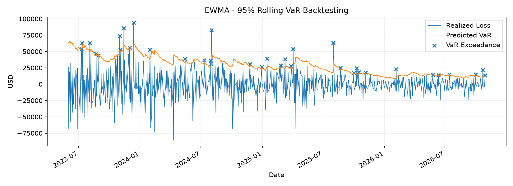

# USD SOFR Swap Pricing and Risk Backtesting

CUHK RMSC5003 group research on a USD 10 million pay-fixed, receive-compounded-SOFR interest rate swap held by the John Hancock Financial Opportunities Fund. Using historical Bloomberg market data, we built daily SOFR curves, valued the swap, and compared three one-day risk forecasts against cashflow-adjusted mark-to-market losses.

## Main Findings

- **Curve selection.** Monotone-convex forward interpolation had the lowest leave-one-tenor-out RMSE in both training and validation. The selected method was fixed before the out-of-sample comparison.
- **95% VaR.** EWMA came closest to the 5% target exception rate. Its conditional coverage test did not reject at the 5% significance level. Historical Simulation and PCA Monte Carlo produced fewer exceptions than expected, consistent with conservative VaR forecasts in this sample, and both were rejected.
- **99% VaR.** The conditional coverage test did not reject any of the three models. With only 5 to 12 exceptions per model, the sample offers limited power to distinguish their coverage.
- **Expected Shortfall.** The pivotal bootstrap interval for the mean ES calibration moment contains zero for EWMA at both levels and PCA Monte Carlo at 99%. The diagnostic measures unconditional calibration and depends on both VaR and ES.

## Study Design and Sample

Historical Simulation (HS), Exponentially Weighted Moving Average (EWMA), and PCA Monte Carlo (PCA_MC) use the same contract, pricing engine, and P&L definition. The out-of-sample evaluation runs from **2023-05-31 to 2026-10-29**. All models and confidence levels use the same **830 valid dates** out of 877 candidates. The common-sample screen excludes 47 dates and 282 forecast rows.

| Failure Category | Dates | Forecast Rows |
|---|---:|---:|
| Non-business forecast or cutoff date | 30 | 180 |
| Realized P&L interval mismatch | 16 | 96 |
| Missing exact cutoff SOFR Index | 1 | 6 |
| Other | 0 | 0 |
| **Total** | 47 | 282 |

## Value at Risk Results

The expected exception rates are 5% at 95% VaR and 1% at 99% VaR. An exception occurs when realized loss exceeds predicted VaR.

| Model | VaR Level | Exceptions | Exception Rate | Kupiec p | Christoffersen Independence p | Conditional Coverage p |
|---|---:|---:|---:|---:|---:|---:|
| HS | 95% | 22 | 2.65% | 0.000676155 | 0.289363 | 0.00176761 |
| EWMA | 95% | 36 | 4.34% | 0.370582 | 0.697049 | 0.620869 |
| PCA_MC | 95% | 17 | 2.05% | 1.05499e-05 | 0.421391 | 4.41552e-05 |
| HS | 99% | 5 | 0.60% | 0.213866 | 0.823117 | 0.450447 |
| EWMA | 99% | 12 | 1.45% | 0.226245 | 0.564065 | 0.407174 |
| PCA_MC | 99% | 6 | 0.72% | 0.398622 | 0.764033 | 0.669452 |

## Expected Shortfall Results

Mean ES is the average forecasted tail loss in USD. The ES calibration moment has a theoretical mean of zero under correct joint VaR and ES calibration. The asymmetric 95% pivotal block-bootstrap interval estimates the mean of this moment.

| Model | ES Level | Mean ES | ES Calibration Moment Mean | Pivotal 95% CI | Equal-tailed p | Zero in CI |
|---|---:|---:|---:|---|---:|:---:|
| HS | 95% | 51,708.33 | -10,699.12 | [-14,759.24, -7,018.41] | 0.0009995 | No |
| EWMA | 95% | 36,109.73 | 2,629.41 | [-2,879.01, 6,942.79] | 0.304914 | Yes |
| PCA_MC | 95% | 44,975.66 | -3,645.62 | [-7,703.36, -415.10] | 0.020949 | No |
| HS | 99% | 78,239.76 | -11,273.62 | [-18,374.10, -6,428.83] | 0.0009995 | No |
| EWMA | 99% | 46,685.99 | 15,941.76 | [-738.47, 29,510.29] | 0.0586224 | Yes |
| PCA_MC | 99% | 58,157.06 | 2,781.40 | [-6,965.46, 10,324.80] | 0.508363 | Yes |

For EWMA at 99%, zero lies in the pivotal interval [-738.47, 29,510.29] (p = 0.0586224). The symmetric interval [1,193.23, 30,690.29] excludes zero (absolute-tail p = 0.035982). This is the only group whose 5% decision differs between the two methods.
The evidence applies to this swap and sample period. Sparse 99% VaR exceptions limit inference,
and the exploratory, unconditional ES diagnostic is sensitive to interval construction,
block length, and time-series dependence.

## Research Outputs

| Area | Results |
|---|---|
| SOFR curve construction | [Method selection and validation](outputs/curve_validation/final_method_recommendation.md) · [Daily zero curves](outputs/curves/zero_curve_panel.csv) |
| IRS valuation | [Daily mark-to-market and P&L](outputs/pricing/irs_mtm_pnl.csv) · [Contract and pricing methodology](docs/irs_pricing_methodology.md) |
| Risk forecasting | [Rolling VaR and ES forecasts](outputs/risk/risk_model_outputs.csv) · [Risk integration validation](outputs/risk/risk_validation_report.md) |
| Backtesting | [Research summary](src/irs_project/backtesting/README.md) · [Full statistics](outputs/backtesting/backtest_results.csv) · [Exclusion audit](outputs/backtesting/excluded_date_summary.csv) |

## Contributions

- **陈美婷** developed the HS, EWMA, and PCA Monte Carlo risk forecasts.
- **Faye Sun** ([@fayeyeye](https://github.com/fayeyeye)) implemented the initial VaR and ES backtesting and model comparison in [PR #4](https://github.com/rOOOOOnn/IRS/pull/4).
- **Ron** developed the data, curve construction, and IRS pricing workflows and finalized the Backtesting integration.

For reproduction, see [environment setup](docs/environment_setup.md).
`uv run python scripts/run_curve_pricing_pipeline.py` runs data preparation, curve construction and IRS
pricing. Run risk forecasts separately with `uv run python scripts/run_risk_models.py`. The backtest can be reproduced from the checked-in inputs with `uv run python scripts/run_backtesting.py`.
