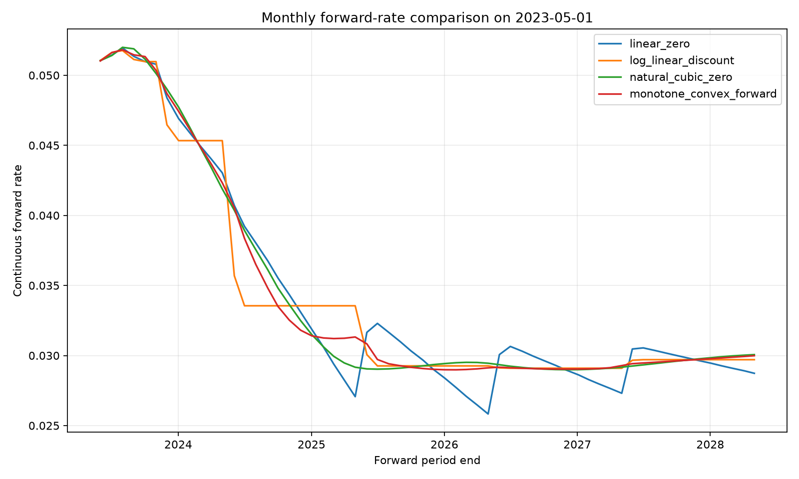
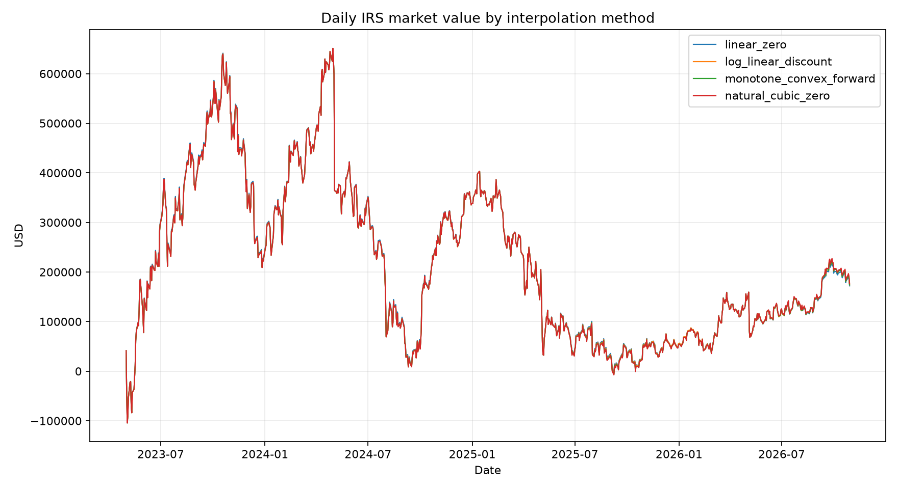

# Financial and Numerical Audit — Yield Curve Construction and IRS Pricing

Audit date: 2026-11-09

Branch reviewed: `codex/yield-curve-irs-pricing`

Implementation commit reviewed: `8820759ff6f568c1f0a01d52fda07566c1f084fb`

## Executive Summary

**Overall assessment: PASS WITH WARNINGS.** No finding invalidates the selected curve method, the
USD 41,392.94 initial IRS value, the daily MTM series, or the cashflow-adjusted P&L. No financial
assumption or interpolation selection was changed during this audit.

- The initial value independently reconciles as
  `USD 45,460,810.21 × (3.4470519% - 3.3560%) = USD 41,392.94`.
- All 2,182 selected daily curves calibrate; the largest absolute calibration residual is
  approximately `1.01e-8 bps`.
- All 87,252 LOTO observations succeed. Interior interpolation and endpoint extrapolation are
  separated, and the Validation-only selector does not use Test results.
- All 882 selected-method valuations succeed. Market-value changes, cashflows, total P&L, Loss,
  and cumulative P&L reconcile to numerical precision.
- There are no `FAIL` findings. The main warnings are that QuantLib's smoothed convex-monotone
  parameterization is an enhanced Hagan–West variant rather than the basic paper parameterization,
  and the realized floating-leg calculation relies on SOFR Index ratios rather than reconstructing
  the compound directly from the separate daily fixing series.

**Merge conclusion:** the branch is suitable for Pull Request and merge within the stated research
scope. The warnings below should remain visible because they define the model variant and the limits
of the current fixing engine.

## Finding Register

| Area | Classification | Conclusion |
|---|---|---|
| Initial IRS valuation and sign | PASS | Value, par-rate spread, leg PVs, annuity, and position sign reconcile. |
| Hagan–West lineage | WARNING | QuantLib implements a Hagan–West-derived convex-monotone method, but the configured 0.3/0.7 parameters are a smoothed enhancement, not the basic 0/1 form. |
| Discount factors, forward continuity, stability | PASS | Pillar discount factors remain positive; integrated forwards reproduce discount ratios; continuity and calibration errors are numerically small. |
| LOTO exclusion and repricing | PASS | Hidden tenors are absent from helper sets and are repriced only after rebuilding the curve. |
| Time-split leakage | PASS | Selection uses Validation interior LOTO RMSE; Test results are reported but not selected on. |
| SOFR realization method | WARNING | SOFR Index is used correctly for compounded factors, but the separate daily SOFR fixing series is not consumed by the pricer. |
| Schedule, day count, and cashflow attribution | PASS | Configured assumptions are applied consistently and settled coupons are counted once. |
| Daily P&L | PASS | All formulas and cumulative reconciliation pass; payment dates do not show coupon-sized artificial P&L jumps after cashflow adjustment. |
| Four-method comparability | PASS | Instruments, quotes, dates, contract, history, and valuation formulas are shared; only curve construction changes. |
| Member A interface | WARNING | Required 1M–5Y levels are complete, but the first differenced row is necessarily null and optional 7Y/10Y gaps propagate into changes. |
| Member B interface | PASS | Schema, sign convention, date range, and row-level completeness match the documented handoff. |
| Automated regression coverage | WARNING | The 21 tests pass, but full-history continuity, payment-date reconciliation, and all-method LOTO isolation are presently audit checks rather than permanent unit tests. |

## 1. Initial IRS Valuation Audit

### Reconciled result

| Item | Audited value |
|---|---:|
| Valuation / assumed effective date | 2023-05-01 |
| Notional | USD 10,000,000.00 |
| Position | Pay Fixed / Receive Floating |
| Contract fixed rate | 3.3560000% |
| Contract-schedule market par rate | 3.4470519% |
| Raw Bloomberg 5Y OIS quote | 3.4445000% |
| Par-minus-fixed spread | 9.1051926 bps |
| Swap annuity per unit notional | 4.5460810214 |
| Dollar annuity | USD 45,460,810.21 |
| PV01 | USD 4,546.08 per bp |
| Fixed-leg PV | USD 1,525,664.79 |
| Floating-leg PV | USD 1,567,057.73 |
| Net market value | **USD 41,392.94** |

The contract-schedule par rate is calculated as:

```text
Par rate = PV Floating / (Notional × sum[accrual fraction × payment-date DF])
         = 3.4470519%
```

The market value then reconciles in two independent forms:

```text
PV Floating - PV Fixed
= 1,567,057.73 - 1,525,664.79
= USD 41,392.94

Dollar annuity × (Par rate - Fixed rate)
= 45,460,810.21 × (3.4470519% - 3.3560%)
= USD 41,392.94
```

The 0.2552bp difference between the raw 5Y OIS quote and the contract-schedule par rate is expected:
the market helper is a two-business-day spot-starting OIS, whereas the research contract starts on
2023-05-01 and has its own adjusted accrual and payment dates.

### Sign convention

`price_irs` defines `Market Value = PV Floating - PV Fixed`. Since the market par rate is above the
contract fixed rate, paying the lower fixed rate is valuable and the initial market value is positive.
A +100bp parallel zero-curve scenario also increases the value from USD 41,392.94 to USD 497,050.61,
an impact of +USD 455,657.67, which is directionally correct for pay-fixed/receive-floating.

**Classification: PASS.**

## 2. Monotone Convex Audit

### Method lineage and parameterization

The implementation constructs `ql.PiecewiseConvexMonotoneForward` with
`ql.ConvexMonotone(0.3, 0.7, False)`. QuantLib documents this interpolator as an enhancement of the
Hagan–West convex-monotone method. QuantLib also states that the basic Hagan–West form is recovered
with monotonicity `1` and quadraticity `0`; the library defaults of quadraticity `0.3` and
monotonicity `0.7` deliberately blend in a smoother quadratic component.

Therefore, the implementation is correctly described as a **QuantLib smoothed Hagan–West-derived
convex-monotone forward curve**, not as a literal implementation of only the basic paper parameters.
The selected method is not changed by this finding.

`forcePositive=False` is an intentional relaxation. It permits the legitimate negative-rate portion
of the sample; it also means the positive-forward guarantee should not be claimed unconditionally.
The observed monthly-forward range is -0.070089% to 5.703866%, with no breach of the configured
-5% to 20% diagnostic bounds.

**Classification: WARNING — naming and model-variant disclosure, not a numerical failure.**

### Discount-factor preservation

The inputs are OIS par rates, not externally supplied discount-factor nodes. “Node preservation” in
this context means that the bootstrapped forward representation integrates back to the same internal
pillar discount factors and exactly reprices the input OIS helpers.

- Initial curve: 11 pillars including the reference date; all discount factors are positive.
- Full history: zero non-positive pillar discount factors across all 2,182 selected curves.
- Maximum input-instrument calibration residual: approximately `1.01e-8 bps`.
- Maximum numerical error in
  `integral(f(t), t1, t2) = -log(DF(t2)/DF(t1))` on initial pillar intervals: `1.52e-11`.
- Maximum pillar-DF difference on an independent repeat build: `0.0`.

These checks support preservation of the bootstrapped discount-factor structure.

**Classification: PASS.**

### Forward continuity and numerical stability

Instantaneous forwards were evaluated immediately to the left and right of every interior pillar.
The maximum observed left/right gap was `2.63e-8` in decimal-rate units, or approximately
`0.0002635 bps`, over the full 2,182-date history. There were no non-finite forward evaluations, no
daily curve failures, and no configured-bound breaches.

The numerical shortcut is reliance on QuantLib's compiled interpolation and iterative bootstrap
rather than a project-owned reimplementation of the Hagan–West case equations. The bootstrap also
uses enlarged search settings (`maxAttempts=5`, factor range 3, 500 evaluations) to accommodate the
historical negative-rate period. These choices improve robustness but should be kept in the method
documentation.



**Classification: PASS, with the parameterization warning above.**

## 3. LOTO Validation Audit

The LOTO implementation performs the following sequence for every available tenor and each of the
four methods:

1. copy all available quotes for the date;
2. construct `remaining` with the held tenor removed;
3. build a new curve only from `remaining`;
4. create a fresh OIS swap for the hidden tenor; and
5. obtain its fair rate from the rebuilt projection/discount curve.

The hidden market quote is used only afterward to calculate the error. It is not passed to an
`OISRateHelper`.

Audit evidence:

- 87,252 / 87,252 saved LOTO observations have `SUCCESS` status.
- 69,796 are classified as `INTERIOR`.
- 17,456 are classified as `ENDPOINT_EXTRAPOLATION`.
- There are zero duplicate `Date + Method + Held_Out_Tenor` keys.
- An independent rebuild sample covered 160 combinations across Training, Validation,
  Inception/Transition, Test, all four methods, and all available tenors.
- The sampled curves contained zero hidden-tenor helper leaks.
- The sampled repriced quotes matched the saved model quotes within `9.71e-17`.

Endpoint extrapolation is enabled only when the held tenor is the first or last available node and is
reported separately. The primary method comparison filters to interior nodes.

### Time leakage

- Split labels are assigned by fixed chronological boundaries from `config/project.yaml`.
- Curve-shape regime thresholds are estimated from Training only.
- `select_global_method` filters the comparison table to `Dataset == VALIDATION` and ranks by
  Validation RMSE.
- Test rows exist for final reporting but do not enter the selector.
- LOTO is cross-sectional within a single date and never borrows quotes from another date.

**Classification: PASS.**

## 4. IRS Cash Flow Audit

### Schedule and conventions

The research contract produces five annual accrual periods. ACT/360 fractions and adjusted payment
dates are:

| Accrual start | Accrual end | Payment date | ACT/360 fraction | Fixed coupon |
|---|---|---|---:|---:|
| 2023-05-01 | 2024-05-01 | 2024-05-03 | 1.0166667 | USD 341,193.33 |
| 2024-05-01 | 2025-05-01 | 2025-05-05 | 1.0138889 | USD 340,261.11 |
| 2025-05-01 | 2026-05-01 | 2026-05-05 | 1.0138889 | USD 340,261.11 |
| 2026-05-01 | 2027-05-03 | 2027-05-05 | 1.0194444 | USD 342,125.56 |
| 2027-05-03 | 2028-05-01 | 2028-05-03 | 1.0111111 | USD 339,328.89 |

The code consistently applies the configured US Government Bond calendar, Modified Following
accrual-date adjustment, two-business-day payment lag, annual fixed frequency, and ACT/360. These
remain explicit research assumptions rather than verified SEC terms.

### Realized and projected compounded SOFR

- A fully realized accrual period uses `SOFR Index(end) / SOFR Index(start)`.
- A fully future period uses `DF(start) / DF(end)`.
- A partially realized period multiplies the realized SOFR Index factor by the curve-implied future
  factor from the valuation date to accrual end.
- `realized_factor` rejects any requested end date after the valuation date.

For 2024-01-02 in the first coupon period:

```text
Realized factor  = 1.0363129892
Projected factor = 1.0176370838
Combined factor  = 1.0545905282
```

The combined value exactly equals the product of the two components in the audit calculation.

The processed SOFR fixing and SOFR Index files each contain 2,143 aligned, unique, non-null dates
from 2018-04-02 through 2026-10-29. However, the pricing engine directly consumes only the SOFR
Index series; the loaded daily fixing series is not used to independently rebuild or cross-check the
compound. This is reasonable for the current zero-lookback, zero-lockout, no-shift baseline because
the official index is itself the compounded measure, but it is not a general fixing-level observation
engine.

**Classification: WARNING — acceptable for the configured baseline, but direct fixing-level
reconstruction should be added before supporting non-zero lookback, observation shift, lockout, or
independent coupon verification.**

### Settled cashflows

Market value includes a coupon only while `payment_date > valuation_date`. The P&L routine assigns a
settled net coupon exactly once when `previous_date < payment_date <= current_date`. This makes the
valuation ex-cashflow on the payment date and prevents double counting.

**Classification: PASS.**

## 5. Daily P&L Audit

The selected-method output was independently reconciled against the market-value series:

```text
MTM_Change(t) = Market_Value(t) - Market_Value(t-1)
Total_PnL(t)  = MTM_Change(t) + Net_Cashflow(t)
Loss(t)       = -Total_PnL(t)
```

- Maximum MTM formula error: `1.31e-10 USD`.
- Maximum Total P&L formula error: `0.0 USD` at saved precision.
- Maximum Loss sign error: `0.0 USD`.
- Final cumulative reconciliation error against
  `V(last) - V(initial) + sum(cashflows)`: `0.0 USD`.

### Payment-date checks

| Payment row | MTM change | Net cashflow | Total P&L | Absolute-P&L percentile vs non-payment days |
|---|---:|---:|---:|---:|
| 2024-05-03 | USD -234,034.92 | USD 207,133.50 | USD -26,901.41 | 86.5% |
| 2025-05-05 | USD -157,274.70 | USD 160,429.54 | USD 3,154.85 | 17.0% |
| 2026-05-05 | USD -77,483.86 | USD 75,581.95 | USD -1,901.91 | 10.7% |

The large ex-coupon drops in market value are offset by the matching settled cashflows. The largest
cashflow-adjusted payment-date P&L, USD 26,901.41, remains below the non-payment-day 90th percentile
of USD 30,523.79. No coupon-sized artificial P&L jump remains after adjustment.

**Classification: PASS.**

## 6. Cross-Method Comparison

All four methods are built inside the same loop from the same date row and identical OIS quote
dictionary. They share the same `OISRateHelper` construction, settlement lag, calendars, day counts,
payment conventions, contract object, SOFR history, schedule, and valuation functions. The method
argument changes only the piecewise curve/interpolator constructor.

Initial-date comparison:

| Method | Fixed-leg PV | Floating-leg PV | Market value | Difference vs selected |
|---|---:|---:|---:|---:|
| Linear zero | USD 1,525,670.17 | USD 1,567,160.63 | USD 41,490.46 | USD 97.52 |
| Log-linear discount | USD 1,525,663.64 | USD 1,567,066.52 | USD 41,402.89 | USD 9.94 |
| Natural cubic zero | USD 1,525,663.90 | USD 1,567,068.66 | USD 41,404.76 | USD 11.82 |
| Monotone convex forward | USD 1,525,664.79 | USD 1,567,057.73 | USD 41,392.94 | USD 0.00 |

Across the full pricing range, each method has exactly 882 successful dates, with zero failed
valuations and zero duplicate date/method keys. Therefore the valuation differences are attributable
to curve construction and interpolation, not convention drift.



**Classification: PASS.**

## 7. Deliverable and Interface Verification

| File | Rows | Coverage | Audit result |
|---|---:|---|---|
| `zero_curve_panel.csv` | 2,182 | 2018-04-02 to 2026-10-29 | Required 1M–5Y nodes have no nulls or duplicate dates. |
| `zero_rate_changes.csv` | 2,182 | 2018-04-02 to 2026-10-29 | Required tenors have one expected null each on the first differenced row. |
| `irs_mtm_by_method.csv` | 3,528 | 2023-05-01 to 2026-10-29 | 882 dates × four methods, all successful. |
| `irs_mtm_pnl.csv` | 882 | 2023-05-01 to 2026-10-29 | No nulls, duplicate dates, or failed statuses. |
| `loto_detail.csv` | 87,252 | 2018-04-02 to 2026-10-29 | All successful; endpoint and interior labels present. |

### Member A

The documented zero-level columns and decimal-rate units match the output. Member A can use
`Zero_1M` through `Zero_5Y` directly and their `Delta_Zero_*` changes after dropping the first row.
The optional 7Y/10Y levels contain one and two nulls respectively; differencing produces three and
five nulls respectively. These optional long-end fields are not needed for the five-year IRS risk
model and should not be silently imputed.

**Classification: WARNING — usable now, but the first-row differencing rule should be stated in the
handoff instructions.**

### Member B

The documented fields `Date`, `IRS_Market_Value`, `MTM_Change`, `Net_Cashflow`, `Total_PnL`,
`Cumulative_PnL`, `Loss`, and `Valuation_Status` are all present. P&L is positive for profit and
`Loss` is its negative, matching the backtesting interface.

**Classification: PASS.**

### Tests

The full local suite passes: **21 passed**. Static code checks and formatting checks also pass, and
the dependency lock resolves successfully. The existing tests cover all four curve constructors,
input calibration, negative rates, hidden-tenor exclusion, sign convention, no-future SOFR use,
scenario repricing, schedules, and output schema retention.

The current test suite does not permanently encode every full-history audit performed here. The
highest-value proposed additions are:

1. a regression test for payment-date cashflow offset and cumulative reconciliation;
2. a convex-monotone pillar continuity/integral test; and
3. a parameterized LOTO isolation test across all four methods.

These are defense-in-depth improvements and are not evidence of a current calculation failure.

**Classification: WARNING — coverage improvement, non-blocking.**

## Assumptions Not Changed

This audit did not change the assumed effective/maturity dates, annual fixed frequency, ACT/360,
calendar, business-day adjustment, payment lag, observation rules, single-curve framework,
ex-cashflow basis, or selected interpolation method. They remain explicitly classified in
`config/contract.yaml` and `config/curve.yaml`.

## References and Audit Evidence

- Hagan and West, [Methods for Constructing a Yield Curve](https://dlu-umich.github.io/docs/HaganWest.pdf).
- QuantLib, [convex-monotone interpolation source and parameter description](https://github.com/lballabio/QuantLib/blob/master/ql/math/interpolations/convexmonotoneinterpolation.hpp).
- Project implementation: `src/irs_project/curves/`, `src/irs_project/pricing/`, and
  `scripts/run_curve_validation.py`.
- Recomputed source data: `data/processed/ois_par_rates_wide.csv`, `sofr_fixings.csv`, and
  `sofr_index.csv`.
- Generated evidence: `outputs/curves/`, `outputs/curve_validation/`, and `outputs/pricing/`.

## Final Readiness Decision

**Ready for Pull Request and merge, with the documented warnings retained.** No numerical evidence
supports changing `monotone_convex_forward` or rewriting the working curve and pricing modules.
Future work should treat fixing-level coupon reconstruction and the proposed regression tests as
controlled enhancements rather than silent changes to the current financial assumptions.
